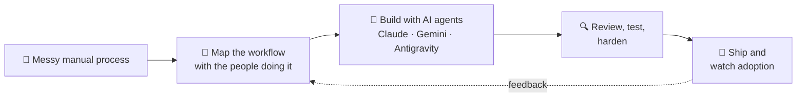

---

## 👋 About me

I wrote production software for a decade — ERP for Motherson's plants, order management for Estée Lauder, an insurance platform for a London insurer. Today I'm **Senior Manager at [Simactricals](https://github.com/simactricals-io)** in Vadodara, leading a team of 9 across administration, HR, procurement and finance, reporting to the CEO and COO.

I never stopped building. The tools my team runs on every day — a policy chatbot, an employee portal, a project tracker, a live test-data dashboard — I designed and shipped myself. My lens: **reduce complexity, don't just manage it.**

---

## 📈 Impact at a glance

<table>
<tr>
<td align="center" width="25%"><h2>90%</h2>fewer routine HR policy queries</td>
<td align="center" width="25%"><h2>~60%</h2>less time on manual reporting</td>
<td align="center" width="25%"><h2>500+</h2>ERP users across ~40 plants in 4 countries</td>
<td align="center" width="25%"><h2>10 yrs</h2>shipping production code</td>
</tr>
</table>

---

## 🚀 What I've built at Simactricals

These are internal tools, so the code is private — each one has a short demo video instead.

<table>
<tr>
<td width="50%" valign="top">

### 🤖 Policy Chatbot
`AI` · [▶ Watch demo](https://milindmishra.xyz/assets/demos/policy-chatbot.mp4)

Employees ask HR questions in plain English and get answers from the company's real policy documents — no more digging through PDFs.

**→ Routine HR queries down 90%**

</td>
<td width="50%" valign="top">

### 📋 Employee Portal
`Internal Tools` · [▶ Watch demo](https://milindmishra.xyz/assets/demos/employee-portal.mp4)

Attendance, leave and reimbursements with a two-step approval flow, replacing paper sign-offs. Built end-to-end with an AI-agent workflow.

**→ Paper sign-offs replaced for all 12 employees**

</td>
</tr>
<tr>
<td width="50%" valign="top">

### 📊 Charging Data Dashboard
`Data` · [▶ Watch demo](https://milindmishra.xyz/assets/demos/charging-dashboard-full.mp4)

Real-time charging test-case analytics, so the team gets self-service answers instead of waiting on manual reports.

**→ Manual reporting time down ~60%**

</td>
<td width="50%" valign="top">

### 🗂️ Project Tracking System
`Internal Tools` · [▶ Watch demo](https://milindmishra.xyz/assets/demos/project-tracking.mp4)

A tracker shaped around how the team actually works, giving leadership visibility without adding process overhead.

**→ Adopted by 3–4 teams**

</td>
</tr>
</table>

---

## 🧭 Career path

| When | Role | Where | Highlights |
|---|---|---|---|
| **2025 → now** | Senior Manager, Administration | **Simactricals** | Leads admin, HR, procurement & finance; builds the team's AI tools |
| **2023 – 2025** | Senior Analyst II, Software Engineering | **DXC Technology** · GCube Insurance, London | Features + production support for a live insurance platform; 99% ticket resolution |
| **2021 – 2023** | Senior Executive | **Wipro** · The Estée Lauder Companies | Ecometry order management, Cubiscan, Stock Sync inventory |
| **2016 – 2021** | Software Engineer | **MothersonSumi Infotech** · Motherson Group | eMPro ERP for 500+ users; Traceability module; 🏅 Star Performer |

---

## 🛠️ How I build with AI

I lead the design and the decisions; AI agents speed up the typing. Every internal tool above was built this way.

---

## 🧰 Tech stack

  

**Domains:** ERP · Supply chain · Insurance platforms · Finished-goods traceability · Procurement & vendor management

---

## 🌄 Off the clock

<table>
<tr>
<td align="center" width="16%">📷 <b>Photography</b> chasing light</td>
<td align="center" width="16%">🚗 <b>Long drives</b> 35,000+ km and counting</td>
<td align="center" width="16%">🍳 <b>Cooking</b> a recipe is a system too</td>
<td align="center" width="16%">🏓 <b>Pickleball</b> + badminton & cricket</td>
<td align="center" width="16%">🌍 <b>Geopolitics</b> the story behind the headlines</td>
<td align="center" width="16%">🧭 <b>New places</b> new cities, new ideas</td>
</tr>
</table>

---

### 🤝 Let's talk operations, HR, or tech-enabled transformation

🏅 Star Performer — Motherson Group &nbsp;·&nbsp; 🎓 <a href="https://milindmishra.xyz/assets/certificates/iit-kanpur-ai-ml.pdf">AI & ML Certificate — IIT Kanpur</a> &nbsp;·&nbsp; ☁️ <a href="https://milindmishra.xyz/assets/certificates/azure-fundamentals-az900.pdf">Azure Fundamentals (AZ-900)</a>

